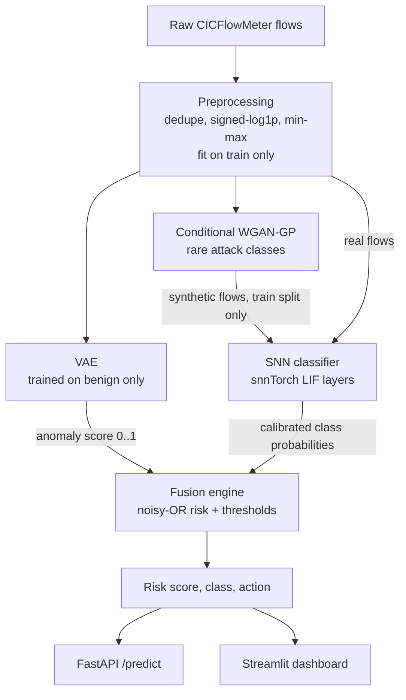

# Hybrid Network Intrusion Detection: VAE + GAN + Spiking Neural Network

A network intrusion detection pipeline that attacks the two problems that make real IDS deployments hard: **analysts drown in false positives**, and **rare attack classes have too few labels** to train on. It combines three models, each doing the job it is best suited for, and fuses them into one **risk score + attack class + recommended action** (`allow` / `monitor` / `block`).

| Problem | Component | What it does |
|---|---|---|
| Unknown / zero-day attacks | **VAE** (unsupervised) | Learns what benign traffic looks like; scores how far a flow is from it |
| Rare attack classes | **Conditional WGAN-GP** | Generates synthetic minority-class flows to augment the *training* set only |
| Edge deployment | **Spiking neural network** (snnTorch) | Sparse, event-driven classifier for low-power inference on routers / IoT gateways |
| Alert fatigue | **Fusion engine** | Noisy-OR risk score with thresholds calibrated to a target false-positive rate |

> **Status.** The full pipeline, API, dashboard and Docker setup are implemented and verified end to end (48 tests) on a CICIDS2017-schema synthetic dataset. **Metrics on the real CICIDS2017 data have not been generated yet**, so this README deliberately reports none. Run `make pipeline` and paste `reports/snn/summary.md` into the [Results](#results) section. The full ablation study is the next milestone ([roadmap](#roadmap)).

## Architecture



At inference only three things run: the preprocessor, the VAE scorer and the SNN. The GAN exists purely at training time.

**How the signals combine** (`src/nids/fusion.py`):

```
p_attack = 1 - P(Benign)                          # SNN, temperature-calibrated
anomaly  = benign-percentile score in [0, 1]      # VAE
risk     = 1 - (1 - p_attack) * (1 - 0.8 * anomaly)
```

Noisy-OR rather than an average, so a confident "benign" from the classifier cannot drown out a strong anomaly signal, which is exactly the zero-day case. A flow the SNN calls benign but the VAE finds anomalous is labelled `Unknown-Anomaly` and is never silently allowed. The `monitor` and `block` thresholds are calibrated on the validation split so benign false-positive rates hit configured targets (0.5% at block, 3% at monitor by default).

## Quickstart

```bash
python -m venv .venv && source .venv/bin/activate
pip install torch                      # or a CUDA build from pytorch.org
pip install -e ".[serve,track,dev]"

make smoke                             # ~1-2 min on CPU, synthetic data, whole pipeline
make test                              # 48 tests
```

`make smoke` generates a synthetic CICIDS2017-schema dataset (same column names, header whitespace, mangled labels, inf/NaN values, duplicates and constant columns as the real files) and runs prepare → VAE → GAN → SNN → calibrate → evaluate. **Its metrics are not a benchmark.** It exists so the exact production code path can be exercised in CI.

### Real data (CICIDS2017)

1. Download the CSVs from the [official Canadian Institute for Cybersecurity page](https://www.unb.ca/cic/datasets/ids-2017.html) (the `MachineLearningCVE` or `TrafficLabelling` bundle) and cite Sharafaldin, Lashkari & Ghorbani (ICISSP 2018).
2. Put all `*.csv` files in `data/raw/cicids2017/`.
3. Run:

```bash
make pipeline          # prepare, train-vae, train-gan, train-snn, calibrate, evaluate
make benchmark         # single-flow CPU latency
```

Expect to need roughly 8-16 GB of RAM for preprocessing (2.8M rows). The models themselves are small MLPs and train comfortably within about 4 GB of GPU memory at the default batch sizes. Run times on the full dataset have not been measured yet.

### Serve and explore

```bash
uvicorn nids.serving.api:app --port 8000     # http://localhost:8000/docs
streamlit run src/nids/dashboard/app.py      # http://localhost:8501
docker compose up --build                    # API + dashboard (artifacts mounted read-only)
docker compose --profile tracking up         # adds an MLflow server on :5000
```

```bash
curl -s localhost:8000/predict -H 'content-type: application/json' \
  -d '{"flows":[{"Flow Duration":1234567,"Total Fwd Packets":12, "...":0}]}'
```

The API accepts raw CICFlowMeter feature names (header whitespace is tolerated), applies the saved preprocessor, and returns per flow: `risk_score`, `anomaly_score`, `attack_probability`, `predicted_class`, `confidence`, `action` and the top-3 class probabilities. It returns 422 listing missing features, and `/health` reports `degraded` (instead of crashing) if artifacts are absent.

## Design decisions

Each of these is a classic way to inflate IDS results if done the other way round. Details and the experiments behind them are in [`docs/design-decisions.md`](docs/design-decisions.md).

- **No leakage.** Exact duplicates are removed before splitting; the scaler, constant-column filter and NaN fill values are fitted on train only; GAN samples never enter validation or test.
- **Realistic evaluation prevalence.** Only the *train* split is capped. Validation and test keep CICIDS2017's natural class mix, so false-positive rates and alert volumes mean something.
- **Behavioural features only.** Flow IDs, IPs, timestamps and (by default) destination port are dropped so models cannot memorise hosts or ports.
- **GAN guard-rails.** Classes with fewer than 20 real train flows are skipped (a GAN would memorise them), synthetic volume per class is capped at 20x the real count, output is snapped onto the real data's point masses, and a fidelity report (real-vs-synthetic discriminator AUC, nearest-neighbour copy check) is written next to the samples.
- **SNN encoding.** `direct` encoding is the default (layer 1 turns analog features into spikes). Pure Bernoulli rate coding is available (`encoding: rate`) but was markedly less accurate in development because sampling noise swamps fine feature differences.
- **Sparse by construction.** A hinge penalty on hidden-layer firing rate (with warm-up) reduces estimated synaptic energy without hurting accuracy in development runs; it can never silence a layer by design.
- **Calibrated probabilities.** Temperature scaling on validation makes `1 - P(Benign)` usable inside the risk formula.

## Results

_Pending: run `make pipeline` on CICIDS2017, then paste the contents of `reports/snn/summary.md` here and commit the figures._

`nids evaluate` produces, on the held-out test split:

| Artifact | Contents |
|---|---|
| `metrics.json`, `summary.md` | Accuracy, balanced accuracy, macro/weighted/rare-class F1, per-class precision/recall/F1, VAE AUROC / AUPRC / TPR@1%FPR, fused risk AUROC, alert-volume table, SNN firing rates and energy proxy |
| `confusion_matrix.png` | Row-normalised SNN confusion matrix |
| `vae_roc.png` | Benign-vs-attack ROC of the unsupervised detector |
| `risk_distribution.png` | Benign vs attack risk scores with the calibrated thresholds |
| `per_class_f1.png` | F1 per class, rare classes marked |
| `action_by_class.png` | allow / monitor / block share per true class |

The alert-volume table compares four strategies on the same flows (SNN-only alerts, VAE-only alerts, fused monitor+block, fused block-only) so the "fewer alerts for analysts" claim is measured rather than asserted.

## Known limitations

- **Single dataset.** CICIDS2017 is from one lab network in 2017 and has documented labelling and flow-construction issues (see Engelen et al., 2021). Results will not transfer one-to-one to production traffic; cross-dataset testing (UNSW-NB15, NSL-KDD) is on the roadmap.
- **Very rare classes.** Heartbleed (11 flows) and Infiltration (36) are too few to model reliably; Heartbleed falls below the GAN threshold and is skipped by design. Per-class numbers for them rest on a handful of test flows.
- **Energy is a proxy.** The SNN is simulated in PyTorch on a CPU/GPU. The reported energy ratio counts synaptic operations with 45 nm per-op energies; it ignores memory traffic and neuron updates and is not a hardware measurement. Latency numbers are for the simulation, not for neuromorphic silicon.
- **Anomaly detector strength depends on the data.** A VAE only flags what looks unlike benign traffic; low-and-slow attacks that mimic benign flows (Infiltration, some web attacks) will be hard for it. That is why it is fused with the supervised model rather than used alone.
- **API is unauthenticated** and meant to sit behind a gateway. It is a reference service, not a hardened product.

## Roadmap

1. **Full ablation study** (next): baseline vs +GAN (per-class F1 on rare classes), unknown-attack hold-out (train without one family, measure VAE and fused detection), SNN vs same-shape ANN (accuracy, latency, energy proxy), encoding comparison, fusion-weight sensitivity. The CLI already supports it: `nids train-snn --no-augment --tag snn_baseline`.
2. Cross-dataset evaluation on UNSW-NB15 and NSL-KDD.
3. Drift monitoring on the API (score-distribution shift against the benign validation quantiles).
4. Export the trained SNN weights for a neuromorphic toolchain (Lava / Loihi, Akida, SpiNNaker).

## Repository layout

```
configs/            default.yaml (real data) and smoke.yaml (CI)
src/nids/
  data/             schema, loader + cleaning + splits, synthetic generator
  models/           vae.py, gan.py, snn.py
  training/         train_vae.py, train_gan.py, train_snn.py
  fusion.py         risk engine, threshold calibration, alert funnel
  inference.py      raw flows -> verdicts (used by API, dashboard, evaluation)
  evaluation.py     metrics, figures, summary.md
  calibrate.py      validation-split threshold fitting
  benchmark.py      single-flow latency
  serving/          FastAPI app and schemas
  dashboard/        Streamlit app
  cli.py            `nids` command
tests/              48 tests (unit + end-to-end on tiny synthetic data + API)
docs/               design decisions, interview notes
Dockerfile, docker-compose.yml, Makefile
```

## Tech stack

| Component | Technology |
|---|---|
| Language | Python 3.10+ (developed on 3.13) |
| Deep learning | PyTorch |
| VAE | PyTorch, custom encoder-decoder with KL warm-up |
| GAN | PyTorch, class-conditional WGAN-GP |
| SNN | snnTorch (leaky integrate-and-fire, surrogate gradients) |
| Data processing | pandas, NumPy, scikit-learn |
| Dataset | CICIDS2017 (primary); UNSW-NB15 / NSL-KDD planned |
| API | FastAPI + Pydantic v2 |
| Dashboard | Streamlit + Altair |
| Containerisation | Docker, Docker Compose |
| Experiment tracking | MLflow (optional; `tracking.enabled: true`) |
| Version control / CI | Git, GitHub |

## License

MIT. CICIDS2017 is subject to its own terms; download it from the original source and cite the authors.
